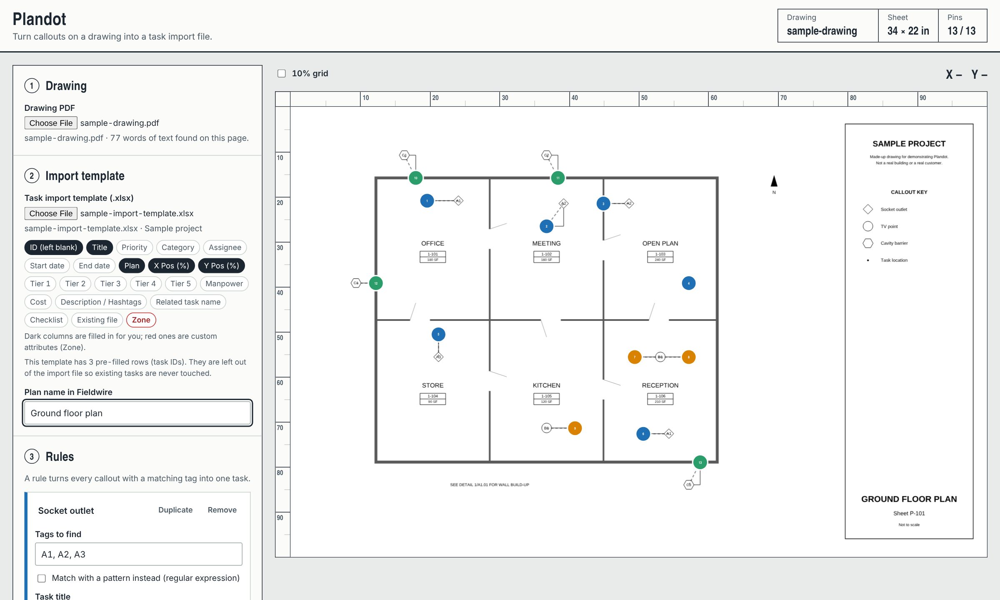

# Plandot

Turn the callouts on a construction drawing into a task import file, with every task pinned on the dot at the end of its leader line.


**Live app:** the link is in the *About* box at the top right of this page. No install, no sign-in.

## What it does

You tell Plandot which tags matter ("A1, A2 and A3 are socket outlets"). It finds every matching callout in the drawing PDF, follows each callout's leader line to the dot it points at, shows the pins on the sheet so you can check them, and fills in your project's import template, ready to import.

```
drawing.pdf  +  import template.xlsx  +  rules   ->   check the pins   ->   import file (.xlsx)
                                                                       ->   marked-up PDF, pin image
```



## Use it

1. Drop the **drawing PDF**.
2. Drop the **import template** (.xlsx) downloaded from your project.
3. Type the **plan name** exactly as it appears in the project.
4. Add **rules**: the tags to find, a task title, and any other column to fill (category, assignee, a custom attribute).
5. Untick any pin you don't want, then **Download import file** and import it.

Rules can be saved to, and loaded from, a small JSON file, so a team can share a library of them.

**Try it without your own files:** drop `samples/sample-drawing.pdf` and `samples/sample-import-template.xlsx` on the page, then press *Load rules* and choose `samples/sample-rules.json`. All three are made up; none comes from a real project.

## Pins go on the dot, not the label

A callout is a tag inside a diamond, circle or hexagon, with a leader line running to a solid dot on the thing it labels. The task belongs on the dot, so that is where the pin goes.

- Leaders with elbows, or drawn in several pieces, are followed to the end.
- A callout with **two leaders gets two pins**. Untick one if you only want one.
- A callout with **no leader keeps its pin on the callout**, and a leader that ends without a dot gets the end of the leader. The pin table's *Pinned on* column and each rule's status line say which happened, so nothing is silently guessed.
- Arrowheads and square blocks are not mistaken for dots, and each callout gets its own dot, not simply the nearest one.
- Each rule can instead pin on the callout text.

Positions are written as percentages from the top-left corner of the sheet, which is how the importer reads them. *Check pin positions first* (under Download) makes nine test tasks on the 10%, 50% and 90% grid lines so you can confirm that on your own account in a minute.

## It follows your template

An import template differs from project to project: adding a custom task attribute adds a column, and hiding one removes a column. Plandot never assumes a column list. It reads the header row of the template you load, finds columns **by name**, and fills only the columns that exist.

- Custom attributes show up as extra fields on every rule. Hidden attributes disappear.
- Load a fresh template whenever the project's attributes change. Saved rule values for a column that no longer exists are ignored, and the page says so.
- If a column the import needs (Title, Plan, X Pos, Y Pos) is missing, the page says so instead of producing a bad file.
- Everything else in the template (formatting, widths, the header block) is left exactly as it was.
- Pre-filled task IDs in the template are left out of the import file, and new tasks have a blank ID, so existing tasks are never touched.
- The importer takes up to 500 tasks per file, so bigger exports are split into numbered parts.

## Privacy

Everything runs in your browser. The drawing, the template and the rules are never uploaded anywhere, and there is no server. Rules are remembered in the browser's own storage on your computer only.

Real drawings and import templates can be confidential or carry personal details, so this repository's `.gitignore` blocks `*.pdf` and `*.xlsx` apart from the two made-up files in `samples/`.

## Limits

- Callouts must be real text in the PDF, as in an export from CAD or Revit. A scan has no text to find.
- Following leaders to dots needs the drawing's line work. A flattened PDF has none and falls back to pinning on the callout text.
- Template column names are matched in English. A template downloaded in another interface language is not recognised yet.
- One PDF page at a time, because each page is its own plan.
- `{room}` in a task title is the nearest room label to the pin. A dot on a wall between two rooms can pick either, and pins on outer walls may be too far from any label to get one. Check titles before importing, or leave the room out of the title.

## Run it yourself

It is a static site: no build step, no server code. From this folder:

```bash
python3 -m http.server 8080      # then open http://localhost:8080
```

Opening `index.html` by double-clicking does not work, because browsers block the page's scripts when they come from a file rather than a web address. Any static host (GitHub Pages, Netlify, Cloudflare Pages) serves it as it is.

## Tests

```bash
npm install
npx playwright install chromium
python3 -m pip install openpyxl     # the tests read the import file back with it
npm test                            # 50 tests
```

GitHub runs the same tests on every push (`.github/workflows/tests.yml`). The tests build their own drawings and templates, or use the made-up files in `samples/`.

To rebuild the samples: `python3 samples/make_sample_drawing.py` (needs `reportlab`) and `node scripts/make-sample-template.mjs`.

## Roadmap

- Match template columns in other languages, or let the user map them by hand
- Symbol detection by image matching, for scanned drawings and unlabelled symbols
- Vision-assisted pins for locations with no label, such as wall ends and cable end points
- CAD (DXF) input for exact line endpoints on a named layer

## About

Plandot is an independent project by Flinn Ginder-Poulsen. It is not an official Fieldwire product; Fieldwire is a trademark of its owner and is named here only to say which import format the tool writes.

All rights reserved: see `LICENSE`. Third-party libraries in `vendor/` keep their own licences: [pdf.js](https://github.com/mozilla/pdf.js) (Apache-2.0), [pdf-lib](https://github.com/Hopding/pdf-lib) (MIT), [JSZip](https://github.com/Stuk/jszip) (MIT or GPL-3.0), and subsets of the Inter (SIL OFL 1.1) and TeX Gyre Heros (GUST) fonts.
